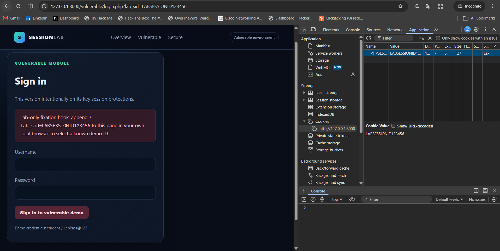
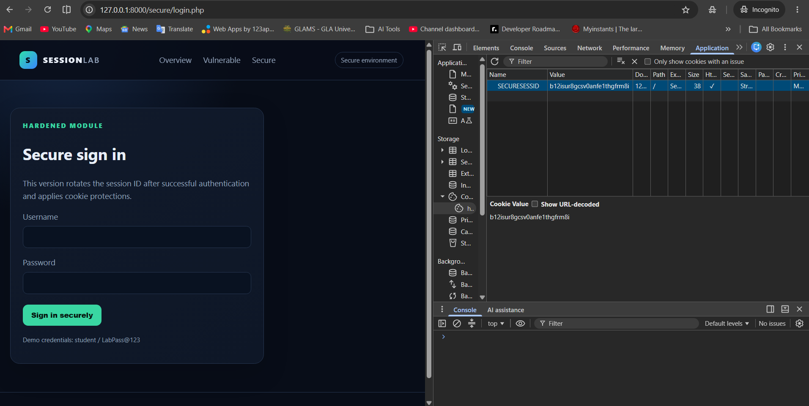

# Secure Session Management Lab

A side-by-side PHP lab that exposes common session vulnerabilities and shows how to fix them — built as part of a cybersecurity course project.

[](https://www.php.net/)
[](https://www.sqlite.org/)
[](LICENSE)

---

## Demo

### Vulnerable module — session fixation
The app intentionally accepts a pre-set session ID (`?lab_sid=LABSESSIONID123456`) so you can prove an attacker who forces that ID before login ends up owning the authenticated session afterward. The full session token is displayed on the dashboard.



### Secure module — hardened protections
Same login flow, but the session ID rotates after authentication, cookies carry `HttpOnly | Secure | SameSite=Strict`, strict mode is enforced, and both idle (5 min) and absolute (30 min) timeouts run on every authenticated request. The real token is never shown; only a SHA-256 fingerprint is rendered for visual comparison.



---

## Project Overview

A side-by-side PHP lab that exposes common session vulnerabilities and shows exactly how to fix them. Each concept is demonstrated in two parallel modules — an intentionally vulnerable one and a hardened one — so you can compare behaviour in real time.

**What it covers:**

- **Session fixation** — forced session IDs vs. `session_regenerate_id(true)` at the privilege boundary
- **Cookie security** — HttpOnly / Secure / SameSite flags and strict-mode enforcement
- **Timeouts** — idle (5 min) and absolute (30 min) expiry, checked on every authenticated request
- **CSRF protection** — token-based validation with timing-safe `hash_equals` comparison
- **Proper logout** — POST-only, full session teardown

**Tech:** PHP 8+ · SQLite via PDO · vanilla HTML/CSS · no framework, no external services

---

## What it covers

| Concept | Vulnerable implementation | Hardened implementation |
|---------|--------------------------|--------------------------|
| **Session fixation** | No rotation; forced session ID persists after login | `session_regenerate_id(true)` at the privilege boundary |
| **Cookie flags** | `HttpOnly=false`, `Secure=false`, `SameSite=Lax` | `HttpOnly=true`, `Secure=true` over HTTPS, `SameSite=Strict` |
| **Strict mode** | Disabled (`ini_set('session.use_strict_mode','0')`) | Enabled by default |
| **Timeouts** | None | Idle 5 min / Absolute 30 min, checked per request |
| **Logout** | `$_SESSION=[]` + basic cookie wipe, GET-accessible | CSRF-protected POST-only form, full cookie & session teardown |
| **CSRF** | Not implemented | Token-based validation via `verify_csrf()` |
| **Session ID exposure** | Full ID shown in plaintext on dashboard | Only a SHA-256 prefix is displayed |

---

## Tech stack

- **Backend:** PHP 8.1+ (pure procedural, no framework)
- **Storage:** SQLite via PDO (`pdo_sqlite`)
- **Auth model:** Plaintext credentials in the DB hashed with `password_hash()` / `password_verify()`
- **UI:** Vanilla HTML + CSS, dark theme

---

## Running locally

No build step or external services required.

```bash
# Clone, then start the built-in server
git clone <repo-url>
cd secure-session-management
php -S 127.0.0.1:8000
```

Open `http://127.0.0.1:8000`. The first visit runs the SQLite bootstrap automatically.

**Demo account:** `student` / `LabPass@123`

---

## Project structure

```
secure-session-management/
├── index.php                # Landing & comparison overview
├── assets/css/style.css     # Dark theme styles
│
├── vulnerable/              # Insecure reference implementation
│   ├── common.php           # Permissive session setup (fixation hook included)
│   ├── login.php            # No rotation after auth
│   ├── dashboard.php        # Exposes raw session ID
│   └── logout.php           # Lightweight cleanup
│
├── secure/                  # Hardened counterpart
│   ├── common.php           # Cookie params, strict mode, timeout middleware
│   ├── login.php            # Regenerates ID at the privilege boundary
│   ├── dashboard.php        # SHA-256 session fingerprint only
│   └── logout.php           # CSRF-verified, destructive cleanup
│
├── includes/                # Shared layout fragments
│   ├── header.php
│   └── footer.php
│
├── config/
│   ├── app.php              # Constants (timeouts), helpers (e(), csrf_token())
│   └── database.php         # PDO → SQLite bootstrap
│
└── database/schema.sql      # CREATE TABLE users
```

---

## Security features in the secure module

| Feature | Code location | Mechanism |
|---------|--------------|-----------|
| Session ID rotation | `secure/login.php` | `session_regenerate_id(true)` after password verification |
| HttpOnly / Secure / SameSite | `secure/common.php` | `session_set_cookie_params([...])` before `session_start()` |
| Strict mode | `secure/common.php` | `ini_set('session.use_strict_mode','1')` |
| Idle timeout | `secure/common.php` | `require_login()` checks `last_activity` against `IDLE_TIMEOUT_SECONDS` |
| Absolute timeout | `secure/common.php` | `require_login()` checks session age against `ABSOLUTE_TIMEOUT_SECONDS` |
| CSRF protection | `config/app.php` / `secure/logout.php` | Opaque random token stored in session, verified with `hash_equals` |
| Proper logout | `secure/logout.php` | POST-verified → wipe `$_SESSION` → expire cookie → `session_destroy()` → redirect |

---

## How to explore

1. **Fixation attack.** Open an incognito window and navigate to  
   `http://127.0.0.1:8000/vulnerable/login.php?lab_sid=LABSESSIONID123456`  
   Log in — the same ID survives authentication. Now repeat with `secure/login.php`; the ID changes after login.

2. **Cookie audit.** Open DevTools → Application → Cookies while on each dashboard. Compare `HttpOnly`, `Secure`, and `SameSite` values between modules.

3. **Timeout test.** Set `IDLE_TIMEOUT_SECONDS = 30` in `config/app.php` and watch the secure module log you out after 30 seconds of inactivity. The vulnerable module never expires.

---

## References

- [OWASP Session Management Cheat Sheet](https://cheatsheetseries.owasp.org/cheatsheets/Session_Management_Cheat_Sheet.html)
- [OWASP Top 10 2021 – A07: Identification and Authentication Failures](https://owasp.org/Top10/A07_2021-Identification_and_Authentication_Failures/)
- [RFC 6265 – HTTP State Management Mechanism](https://datatracker.ietf.org/doc/html/rfc6265)
- [PHP Session Security](https://www.php.net/manual/en/session.security.php)

---

## License

MIT — see [LICENSE](LICENSE) for details. This code is educational; do not deploy the vulnerable module outside localhost.

---

## Share / Contribute

This project is part of a cybersecurity coursework portfolio. Copy-paste-ready blurbs for sharing:

**Short (Projects section):**

> Secure Session Management Lab — a side-by-side PHP lab comparing an intentionally vulnerable session implementation against a hardened one. Covers session fixation, cookie security (HttpOnly/Secure/SameSite), idle/absolute timeouts, CSRF protection, and proper logout. PHP 8 + SQLite, no framework. [github.com/PrakarshKaushik11/Secure-Session-Management-Project](https://github.com/PrakarshKaushik11/Secure-Session-Management-Project)

**Long (post):**

> 🛡️ New project: **Secure Session Management Lab**
>
> Built a side-by-side PHP lab that exposes common session vulnerabilities and shows exactly how to fix them — comparing an intentionally vulnerable module against a hardened one:
>
> • **Session fixation** — forced session IDs vs. `session_regenerate_id(true)` at the privilege boundary
> • **Cookie security** — HttpOnly/Secure/SameSite flags, strict-mode enforcement
> • **Timeouts** — idle (5 min) + absolute (30 min) expiry, checked on every authenticated request
> • **CSRF protection** — token-based validation with timing-safe `hash_equals` comparison
> • **Proper logout** — POST-only, full session teardown
>
> Pure PHP 8 + SQLite, no framework, no external services. Each module has a live comparison dashboard so you can audit cookie attributes and session behaviour in real time.
>
> GitHub: [PrakarshKaushik11/Secure-Session-Management-Project](https://github.com/PrakarshKaushik11/Secure-Session-Management-Project)
>
> #cybersecurity #php #websecurity #sessionmanagement #owasp

